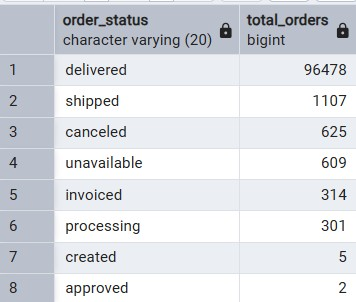
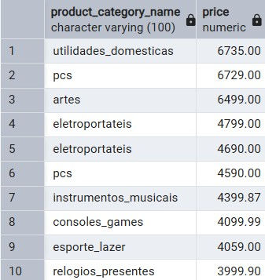
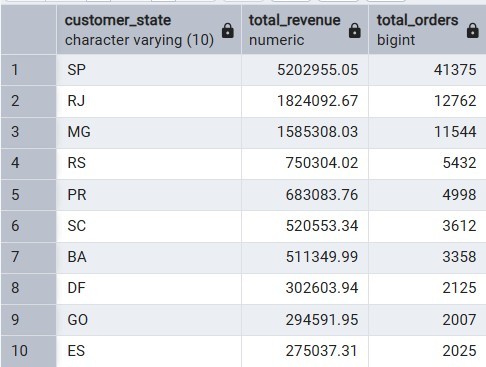
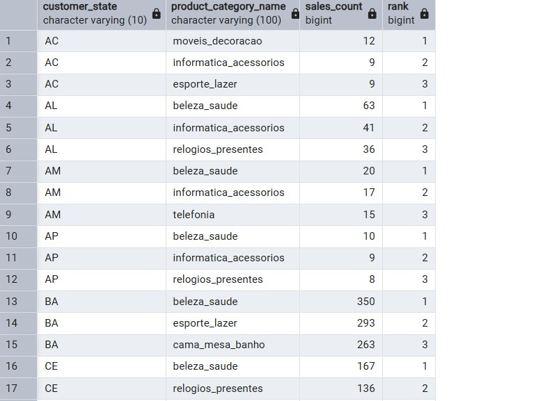
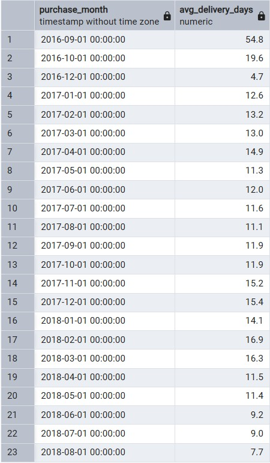

# Анализ данных e-commerce платформы Olist (SQL)

## О проекте
Данный проект представляет собой исследовательский анализ данных бразильского маркетплейса Olist. 
**Цель:** изучить поведение пользователей, выявить самые прибыльные регионы и популярные категории товаров, а также проанализировать логистику и ценообразование.

**Стек:** PostgreSQL, pgAdmin, SQL.

## Структура репозитория
*   `schema.sql` — SQL-код для создания таблиц и типов данных.
*   `queries.sql` — файл со всеми аналитическими запросами проекта.
*   `query4_full.csv` — полный выгруженный результат сложного запроса с оконными функциями (81 строка).
*   `*.jpg` — скриншоты результатов запросов из pgAdmin.

## Ключевые выводы (Инсайты)
1.  **Надежность сервиса:** Из 99 441 заказа **96 478 успешно доставлены** (около 97%). Доля отмененных заказов минимальна — всего 625, что говорит о высокой стабильности логистики.
2.  **Географическая концентрация:** Штат Сан-Паулу (SP) — абсолютный лидер, приносящий выручку **5 202 955.05**, что в 2,8 раза больше, чем у штата Рио-де-Жанейро (RJ), который находится на втором месте (1 824 092.67).
3.  **Премиум-сегмент:** Самыми дорогими покупками в датасете оказались товары категорий `utilidades_domesticas` (6 735.00), `pcs` (6 729.00) и `artes` (6 499.00).
4.  **Региональные предпочтения:** Спрос сильно зависит от географии. В 16 штатах лидируют товары для красоты и здоровья (`beleza_saude`), но в самых густонаселенных штатах (SP, RJ, MG, RS) первое место занимают товары для дома `cama_mesa_banho`.
5.  **Скорость доставки:** Наблюдается явный тренд на улучшение логистики. К концу 2018 года среднее время доставки сократилось до **7.7 дней** (по сравнению с 11-15 днями в 2017 году).

---

## Результаты SQL-запросов

### 1. Распределение заказов по статусам
*Бизнес-вопрос: Какая доля заказов доходит до клиента?*

### 2. Топ-10 самых дорогих товаров
*Бизнес-вопрос: Какие категории товаров представлены в премиум-сегменте?*

### 3. Выручка по штатам
*Бизнес-вопрос: Какие регионы приносят больше всего денег?*
*(Использован тройной JOIN таблиц заказов, позиций и клиентов)*

### 4. Топ-3 категории товаров в каждом штате
*Бизнес-вопрос: Какие товары популярны в каждом регионе?*
*(Использованы CTE и оконные функции `ROW_NUMBER`)*
> Полный список из 81 строки доступен в файле [query4_full.csv](query4_full.csv)

### 5. Анализ времени доставки
*Бизнес-вопрос: Сколько времени в среднем занимает доставка?*

**Детальный разбор динамики доставки:**
*   **Аномалия старта (Сентябрь 2016):** 54.8 дней. Скорее всего, связано с запуском платформы, малым количеством заказов и отсутствием отлаженных процессов.
*   **Стабилизация (2017 год):** Время доставки колеблется в районе 11–15 дней.
*   **Оптимизация (2018 год):** Виден четкий тренд на улучшение. К лету 2018 года (июль-август) время доставки сократилось до **9.0 и 7.7 дней** соответственно. Это говорит об успешном масштабировании логистики компанией.

---

## Как запустить проект локально
1. Скачайте датасет [Brazilian E-Commerce Public Dataset by Olist](https://www.kaggle.com/datasets/olistbr/brazilian-ecommerce) с Kaggle.
2. Выполните скрипт `schema.sql` в вашей базе данных PostgreSQL для создания таблиц.
3. Импортируйте CSV-файлы (orders, order_items, customers, products, payments) в созданные таблицы.
4. Откройте `queries.sql` и выполните запросы для получения аналитики.
